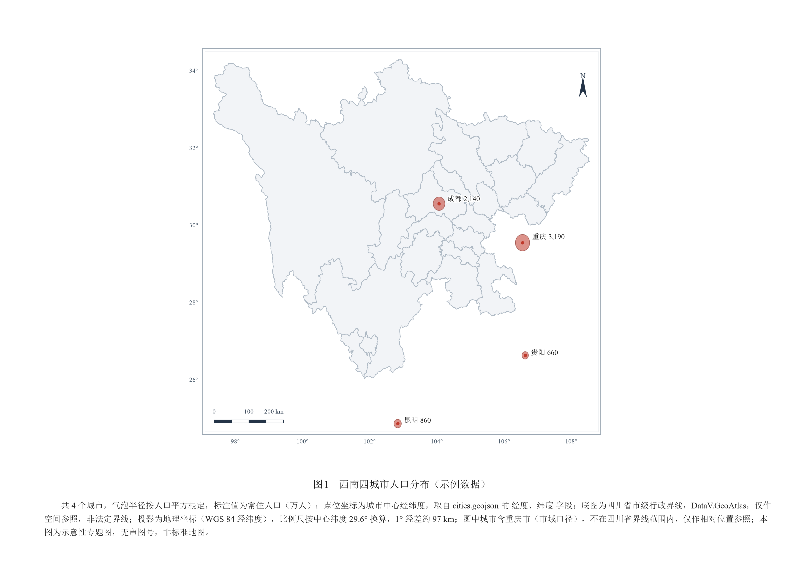

# WGS84 与 GCJ-02 坐标互转

两个转换函数与一个命令行工具：把含经纬度的 CSV 校验后转成 GeoJSON，可选用 WGS84 与 GCJ-02 互转，可选出散点图。



图 1　西南四城市人口分布（示例数据）

## 内容

| 文件 | 作用 |
|---|---|
| `coord_transform.py` | `wgs84_to_gcj02(lng, lat)`、`gcj02_to_wgs84(lng, lat)` 两个函数，无第三方依赖 |
| `points.py` | 命令行：CSV → GeoJSON，可选坐标转换与散点图 |
| `make_map.py` | 由 `cities.geojson` 与 `四川省.geojson` 出示例图 `cities_map.png` |
| `_caption.py` | 图题与图注排版 |
| `cities.geojson` | 4 个城市点位（城市、省份、经度、纬度、人口，人口单位万人） |
| `四川省.geojson` | 21 个市州行政界线，示例图底图 |

## 转换函数

```python
from coord_transform import wgs84_to_gcj02, gcj02_to_wgs84

lng, lat = wgs84_to_gcj02(104.066, 30.572)   # WGS84 → GCJ-02
lng, lat = gcj02_to_wgs84(104.073, 30.575)   # GCJ-02 → WGS84
```

实现为 GCJ-02 的公开近似式：克拉索夫斯基椭球长半轴 6378245.0 m、第一偏心率平方
0.00669342162296594323，用三角级数拟合经纬偏移量。输入落在 72.004—137.8347°E、
0.8293—55.8271°N 之外时按不偏移处理，原样返回。

`gcj02_to_wgs84` 用正向式单次反解：先算出 WGS84 → GCJ-02 的偏移量，再在输入坐标上减去该偏移。
这是通行做法，不是严格的迭代反解，城际量级下残差在米级以内，不能当作测绘精度使用。

## 命令行

```bash
python points.py --input cities.csv                       # → points.geojson
python points.py --input cities.csv --convert wgs2gcj --map   # 转换后再出散点图
```

| 参数 | 说明 |
|---|---|
| `--input` | 输入 CSV，必填，需含 `城市`、`经度`、`纬度` 三列 |
| `--output` | 输出 GeoJSON，默认 `points.geojson` |
| `--convert` | `none`（默认）/ `wgs2gcj` / `gcj2wgs` |
| `--map` | 追加输出 `points_map.png`（300 dpi，图注置图下） |

坐标先做数值化与范围校验，越界或非数值记录不入库，终端打印原始记录数与无效记录数。

## 示例图

`python make_map.py` 输出 `cities_map.png`（3507 × 2481 px，300 dpi），画幅为 A4 横版：

- 底图为四川省市级界线，点位为 4 个城市中心经纬度，气泡半径按人口平方根定；
- 图内不放标题与图号块，图号与题名居中置图下，图注置题名下方；
- 图廓为双线，四周注经纬度刻度；指北针在图廓内右上贴边；分段比例尺 0 / 100 / 200 km；
- 字体中文宋体、西文 Times New Roman，同一层级内不加粗。

## 示例数据

| 城市 | 经度 | 纬度 | 人口（万人） |
|---|---|---|---|
| 成都 | 104.066 | 30.572 | 2140 |
| 重庆 | 106.551 | 29.563 | 3190 |
| 昆明 | 102.833 | 24.880 | 860 |
| 贵阳 | 106.630 | 26.647 | 660 |

人口为示例数值，不是统计口径的正式数据。重庆市为市域口径，不在四川省界线范围内，图中只表示相对位置。

## 已知局限

- 只实现 WGS84 与 GCJ-02 互转；BD-09 需在 GCJ-02 基础上再做一次偏移，CGCS2000 与 WGS84 在本级精度下可视为一致，均未实现
- GCJ-02 反解为单次近似反解，不是迭代解，残差不保证在厘米级
- 转换不写逐条日志，只有终端汇总计数
- `四川省.geojson` 界线非法定界线，示例图无审图号，非标准地图
